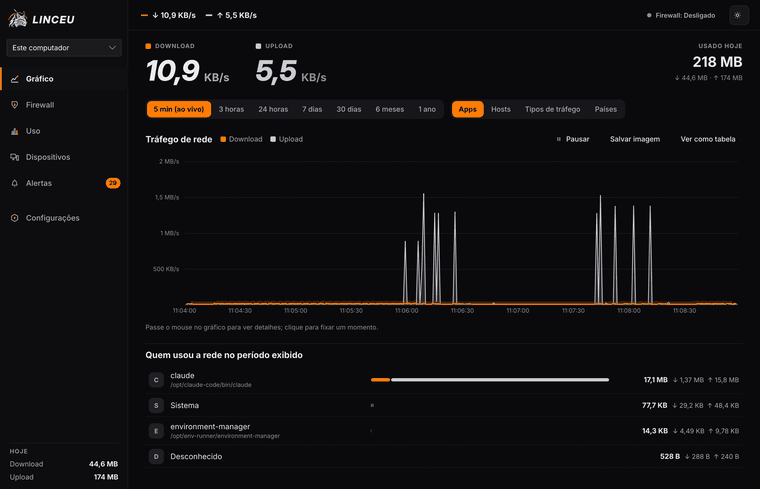
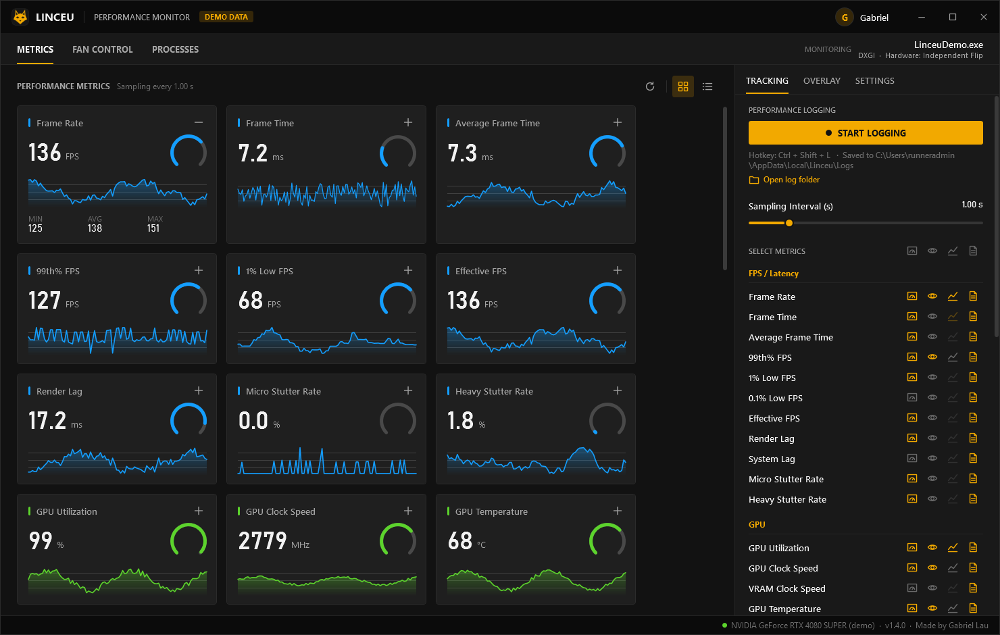

[English](README.md) · [Português](README.pt-BR.md) · [简体中文](README.zh-CN.md)

  

### 👋 Hi, I'm Gabriel

I build practical software for Windows, infrastructure monitoring and the web — from network and hardware diagnostics to automation, healthcare workflows and interactive tools.

My focus is on **clear interfaces, useful features and dependable everyday workflows**.

### ⚡ Flagship projects

<table>
<tr>
<td width="50%" valign="top">
   
  <b>🛡️ Linceu — Network Monitor</b> 
  A native network monitor and application firewall, written in **Rust with Slint**. It tracks traffic per app, hosts and network devices, with alerts and local history.
</td>
<td width="50%" valign="top">
   
  <b>📈 Linceu Performance Monitor</b> 
  A Windows performance monitor with an in-game overlay for FPS, frame times, GPU/CPU metrics and stutter, plus **fan curves** and CSV session logging.
</td>
</tr>
</table>

### ✨ More things I've built

<table>
<tr>
<td width="33%" align="center"></td>
<td width="33%" align="center"></td>
<td width="33%" align="center"></td>
</tr>
<tr>
<td valign="top"><b>MediFlow</b> A clinic management system with check-in, specialty queues, doctors' workstations, electronic records and a live waiting-room display. Built with Node.js, JavaScript and SQLite.</td>
<td valign="top"><b>Kativa Wear</b> A curated fashion storefront with administration, cloud deployment and automated checks for product price and availability. Built with Node.js, Cloudflare Pages and D1.</td>
<td valign="top"><b>Hawk Thunder</b> A War Thunder companion website with ballistics calculations and interactive target maps, powered by published game data.</td>
</tr>
</table>

### 🧰 Utilities & experiments

- **[Conversor PDF](https://github.com/zezim7/Conversor-PDF)** — Windows tool for converting and merging PDFs, including images and scanned documents.
- **[GLPI Planejador](https://github.com/zezim7/glpi-automacao)** — Chrome/Edge extension to automate planning new GLPI support tickets with guardrails.
- **[Recarregar Automaticamente](https://github.com/zezim7/recarregar-automaticamente)** — Chrome extension that refreshes tabs at separately configurable intervals.
- **GPU Fan Control** — Windows fan-control experiment using C# and hardware-monitoring libraries.
- **Zabbix Toolkit** — Monitoring templates and scripts for Windows, services and infrastructure.
- **Linceu Website** — Web experience for the performance-monitoring project, built with React, TypeScript and Vite.

### 🛠️ Tools & technologies

**Slint · Cloudflare Pages · D1 · PowerShell · Zabbix**

---

I enjoy building software that makes complex tasks feel simpler. · [GitHub](https://github.com/zezim7)
