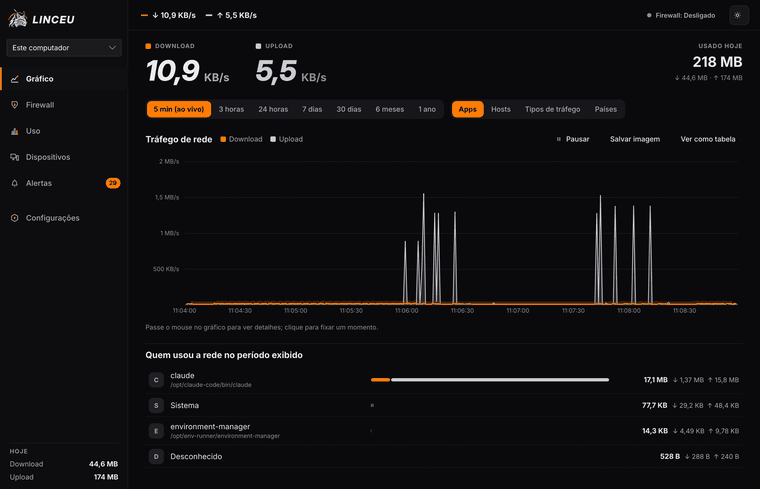
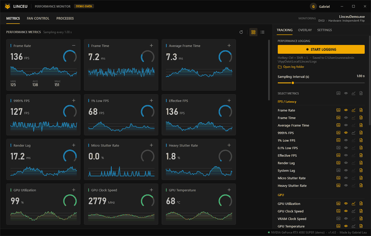

[Português](https://github.com/zezim7/zezim7/blob/main/README.md) · [English](https://github.com/zezim7/zezim7/blob/main/README.en.md) · [简体中文](https://github.com/zezim7/zezim7/blob/main/README.zh-CN.md)

## 👋 Olá! Eu sou o Gabriel

Gosto de criar **ferramentas que resolvem problemas reais** — desde aplicativos para Windows até extensões de navegador que simplificam tarefas repetitivas.

Meu foco é transformar necessidades do dia a dia em soluções **práticas, funcionais e fáceis de usar**.

## 🚀 Projetos em destaque

### Linceu

Desenvolvi o Linceu em Rust, com interface em Slint, para ver quais aplicativos usam a internet, quanto tráfego geram e com quais servidores se conectam. O firewall permite bloquear a conexão de um aplicativo diretamente no monitor.

### Linceu Performance Monitor

Criei este monitor para acompanhar o desempenho de jogos no Windows. A sobreposição exibe FPS, tempo de quadro e temperaturas durante a partida. Depois, posso analisar a sessão em CSV e ajustar as curvas das ventoinhas.

### Outros projetos

| Projeto | O que faz | Tecnologias |
| :--- | :--- | :--- |
| **Kativa Wear** | Vitrine de moda com painel de curadoria e verificação automática de preços e disponibilidade. | Node.js, Cloudflare Pages, D1 |
| 📄 **[Conversor PDF](https://github.com/zezim7/Conversor-PDF)** | Aplicativo para Windows que converte diferentes formatos em PDF, combina documentos e oferece recursos para imagens e digitalização. | `C#` `PowerShell` `.NET Framework` |
| 🎫 **[GLPI Planejador](https://github.com/zezim7/glpi-automacao)** | Extensão para Chrome e Edge que automatiza o planejamento de chamados novos no GLPI, com regras para evitar ações fora do contexto esperado. | `JavaScript` `HTML` `Extensões` |
| 🔄 **[Recarregar Automaticamente](https://github.com/zezim7/recarregar-automaticamente)** | Extensão para Chrome que atualiza abas em intervalos configuráveis, com controle independente para cada aba. | `JavaScript` `HTML` `CSS` |

## 🛠️ Tecnologias e ferramentas

## 🎯 O que gosto de desenvolver

- **Automações:** menos tarefas manuais, mais eficiência.
- **Aplicativos desktop:** ferramentas úteis para o Windows.
- **Extensões de navegador:** pequenas soluções que economizam tempo.
- **Experiência de uso:** interfaces diretas e processos simples.

---

*💡 Código bom é aquele que torna a vida de alguém mais simples.*

🔗 [github.com/zezim7](https://github.com/zezim7)
