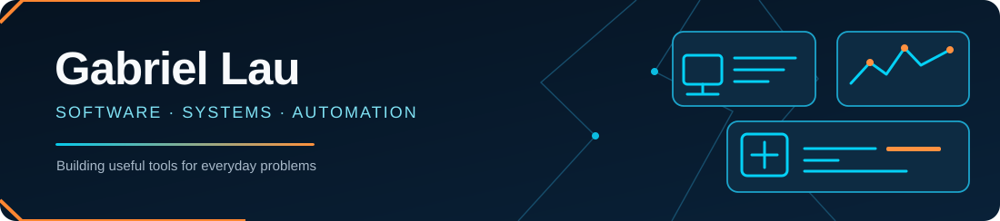
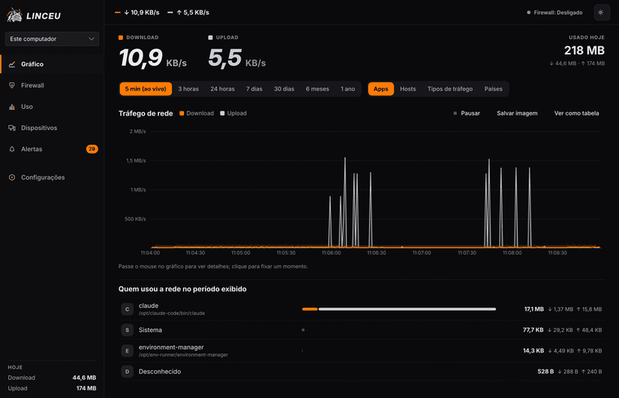
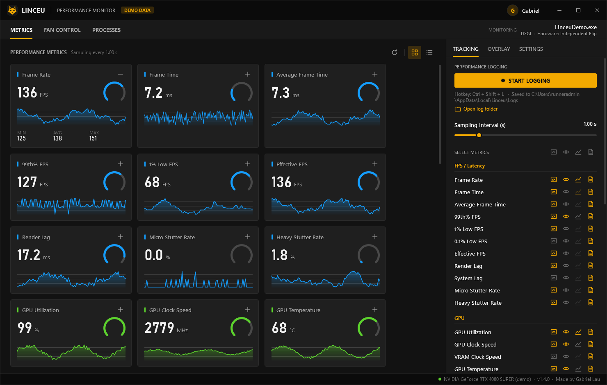

[English](README.md) · [Português](README.pt-BR.md) · [简体中文](README.zh-CN.md)

  

### 👋 Olá! Eu sou Gabriel

Desenvolvo soluções práticas para Windows, monitoramento de infraestrutura e web — desde diagnósticos de rede e hardware até automação, sistemas de saúde e ferramentas interativas.

Meu foco é criar **interfaces claras, recursos úteis e fluxos confiáveis para o dia a dia**.

### ⚡ Projetos principais

<table>
<tr>
<td width="50%" valign="top">
   
  <b>🛡️ Linceu — Network Monitor</b> 
  Monitor de rede e firewall por aplicativo, desenvolvido em **Rust com Slint**. Acompanha tráfego por programa, servidores e dispositivos da rede, com alertas e histórico local.
</td>
<td width="50%" valign="top">
   
  <b>📈 Linceu Performance Monitor</b> 
  Monitor de desempenho para Windows com overlay em jogos para FPS, tempos de quadro, GPU/CPU e engasgos, além de **curvas de ventoinhas** e registro de sessões em CSV.
</td>
</tr>
</table>

### ✨ Outros projetos que desenvolvi

<table>
<tr>
<td width="33%" align="center"></td>
<td width="33%" align="center"></td>
<td width="33%" align="center"></td>
</tr>
<tr>
<td valign="top"><b>MediFlow</b> Sistema de gestão para clínicas com check-in, filas por especialidade, área médica, prontuário e painel de chamadas em tempo real. Node.js, JavaScript e SQLite.</td>
<td valign="top"><b>Kativa Wear</b> Vitrine de moda com curadoria, administração, publicação na nuvem e verificação automática de preços e disponibilidade. Node.js, Cloudflare Pages e D1.</td>
<td valign="top"><b>Hawk Thunder</b> Site complementar de War Thunder com cálculos de balística e mapas interativos de alvos, usando dados publicados do jogo.</td>
</tr>
</table>

### 🧰 Utilitários e experimentos

- **[Conversor PDF](https://github.com/zezim7/Conversor-PDF)** — Ferramenta Windows para converter e juntar PDFs, incluindo imagens e documentos digitalizados.
- **[GLPI Planejador](https://github.com/zezim7/glpi-automacao)** — Extensão para Chrome/Edge que automatiza o planejamento de novos chamados GLPI com regras de segurança.
- **[Recarregar Automaticamente](https://github.com/zezim7/recarregar-automaticamente)** — Extensão Chrome que recarrega abas em intervalos configuráveis por aba.
- **GPU Fan Control** — Experimento de controle de ventoinhas no Windows com C# e bibliotecas de monitoramento de hardware.
- **Zabbix Toolkit** — Templates e scripts de monitoramento para Windows, serviços e infraestrutura.
- **Linceu Website** — Experiência web para o projeto de monitoramento de desempenho, desenvolvida com React, TypeScript e Vite.

### 🛠️ Tecnologias e ferramentas

**Slint · Cloudflare Pages · D1 · PowerShell · Zabbix**

---

Gosto de desenvolver software que simplifica tarefas complexas. · [GitHub](https://github.com/zezim7)
