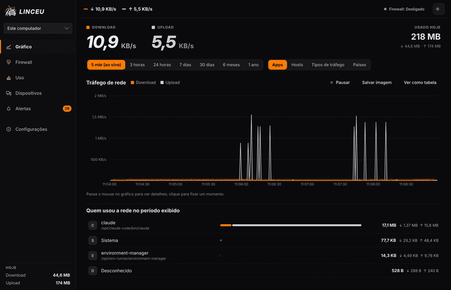
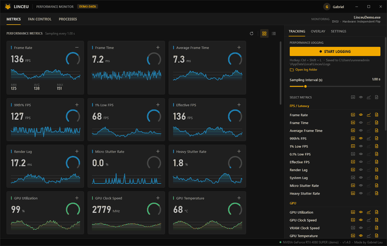

[Português](https://github.com/zezim7/zezim7/blob/main/README.md) · [English](https://github.com/zezim7/zezim7/blob/main/README.en.md) · [简体中文](https://github.com/zezim7/zezim7/blob/main/README.zh-CN.md)

# 你好，我是 Gabriel 👋

我喜欢开发 Windows 应用和浏览器扩展，帮人们解决日常工作中遇到的问题。从合并扫描件到安排工单，我希望这些工具用起来顺手，也能让大家少做些重复操作。

## 精选项目

### Linceu

我用 Rust 和 Slint 开发了 Linceu，用来查看哪些应用正在联网、各自用了多少流量，以及它们连接了哪些服务器。内置防火墙支持直接阻止指定应用联网。

### Linceu Performance Monitor

我开发这款 Windows 工具来观察游戏运行表现。游戏内的悬浮面板会显示帧率、帧时间和温度，还可以将监测记录导出为 CSV 供后续分析，并自定义风扇转速曲线。

### 其他项目

| 项目 | 功能 | 使用的技术 |
| --- | --- | --- |
| **Kativa Wear** | 时尚商品展示网站，带有选品管理后台，可自动检查价格和库存状态。 | Node.js, Cloudflare Pages, D1 |
| [Conversor PDF](https://github.com/zezim7/Conversor-PDF) | 在 Windows 上将多种格式的文件转换为 PDF，支持合并文档、处理图像和扫描。 | C#、PowerShell、.NET Framework |
| [GLPI Planejador](https://github.com/zezim7/glpi-automacao) | 在 Chrome 和 Edge 中自动为 GLPI 的新工单安排处理时间，通过规则判断何时执行操作。 | JavaScript、HTML |
| [Recarregar Automaticamente](https://github.com/zezim7/recarregar-automaticamente) | 自动刷新 Chrome 标签页，可以为每个标签页单独设置刷新间隔。 | JavaScript、HTML、CSS |

## 常用技术与工具

## 我喜欢做的开发工作

我用自动化减少手动操作，为 Windows 开发实用的桌面工具，也会写一些节省时间的浏览器扩展。设计这些工具时，我很看重界面是否直观、操作步骤是否简单。

*好的代码能让别人的生活轻松一点。*

[查看我的所有仓库](https://github.com/zezim7?tab=repositories)
